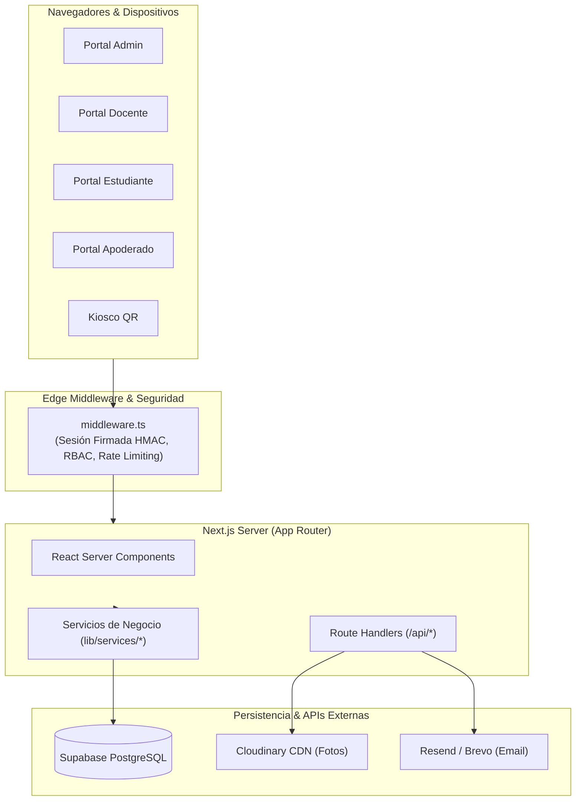

# ColeSistemaMini

> Plataforma SaaS integral y ultraliviana de gestión escolar, control de asistencia QR y evaluación curricular CNEB para colegios de Educación Básica Regular (Inicial, Primaria y Secundaria).

[](https://nextjs.org/)
[](https://www.typescriptlang.org/)
[](https://tailwindcss.com/)
[](https://supabase.com/)
[](https://vitest.dev/)
[](LICENSE)

🌐 **Demo en Producción:** [https://SistemaGestionAcademica.vercel.app](https://SistemaGestionAcademica.vercel.app)

---

## Qué hace

ColeSistemaMini centraliza la gestión académica, operativa y formativa de instituciones educativas mediante módulos diseñados para alta velocidad:

- **Control de Asistencia Bi-Modal:**
  - **Modo Kiosco de Portería (`/asistencia`):** Escaneo de carnets QR por cámara o pistola lectora USB con confirmación auditiva instantánea y alertas visuales.
  - **Toma Rápida Docente (`/docente/asistencia`):** Marcación con estado "Presente" por defecto y cambio de excepciones (*Tardanza*, *Falta*, *Justificado*) con un solo clic.
- **Evaluación Curricular CNEB & Escala Vigesimal:**
  - Registro de notas en escala oficial cualitativa (**AD**, **A**, **B**, **C**) y cuantitativa (0–20).
  - Llenado masivo por columna y asistente inteligente de conclusiones descriptivas formativas.
  - Generación de libretas de notas oficiales en PDF y cuadro de honor institucional.
- **Exportador Oficial SIAGIE (MINEDU):**
  - Generación de archivos CSV con codificación UTF-8 con BOM listos para la carga directa en el sistema estatal peruano.
- **Portales Especializados por Rol (RBAC):**
  - **Administrador (`/admin`):** Matrículas masivas, perfil 360° del alumno (11 pestañas de seguimiento), horarios, asignación docente y auditoría.
  - **Docente (`/docente`):** Gestión de aula, programación de tareas y exámenes, tutoría y semáforo de riesgo académico.
  - **Estudiante (`/estudiante`):** Carnet digital QR, horario interactivo, aula virtual LMS y entrega de tareas con control de vencimiento.
  - **Apoderado (`/apoderado`):** Vista consolidada multi-hijo, notificaciones de asistencia en tiempo real, libretas y contacto directo con docentes.
- **Admisiones & Generador Masivo de Carnets:**
  - Asistente de matrícula individual en 6 pasos e importación masiva desde archivos Excel/CSV.
  - Generación en 1 clic de planillas A4 con guías de corte listas para impresión de 8 carnets QR por lámina.
- **Comunicados & Notificaciones Multicanal:**
  - Envío segmentado de circulares y citaciones (por nivel, grado, sección o rol).
  - Integración para envío de resúmenes por WhatsApp y correos electrónicos transaccionales vía Resend/Brevo.

---

## Arquitectura (diagrama + enlace a docs/ARCHITECTURE.md)

El sistema emplea la arquitectura moderna de Next.js App Router combinada con servicios en la nube para autenticación, base de datos y almacenamiento de archivos.



Consulta el detalle completo en el documento de arquitectura:  
👉 **[Ver Especificación Detallada en docs/ARCHITECTURE.md](docs/ARCHITECTURE.md)**

---

## Inicio rápido

### Requisitos previos
- **Node.js:** Versión 18.17.0 o superior (recomendado Node.js 20 LTS).
- **Gestor de paquetes:** `npm`, `pnpm` o `yarn`.
- **Python:** Versión 3.10+ (opcional, solo para ejecutar la suite de pruebas E2E automatizadas).

### Instalación

1. **Clonar el repositorio:**
   ```bash
   git clone https://github.com/Alessander9/ColeSistemaMini.git
   cd ColeSistemaMini
   ```

2. **Instalar dependencias de Node.js:**
   ```bash
   npm install
   ```

3. **Configurar las variables de entorno:**
   ```bash
   cp .env.example .env.local
   ```
   *(Edita `.env.local` con tus credenciales de Supabase y una clave secreta de sesión).*

4. **Iniciar el servidor de desarrollo:**
   ```bash
   npm run dev
   ```
   Abre [http://localhost:3000](http://localhost:3000) en tu navegador.

5. **Compilar para producción:**
   ```bash
   npm run build
   npm start
   ```

---

## Configuración (.env.example)

El archivo `.env.example` incluye las variables requeridas por el proyecto:

```bash
# Conexión con Supabase (Base de datos y Auth)
NEXT_PUBLIC_SUPABASE_URL=https://your-project-id.supabase.co
NEXT_PUBLIC_SUPABASE_ANON_KEY=your-anon-key
SUPABASE_SERVICE_ROLE_KEY=your-service-role-key

# Clave criptográfica para firmas de sesión (Mínimo 32 caracteres)
# Generar con: node -e "console.log(require('crypto').randomBytes(48).toString('base64url'))"
SESSION_SECRET=your_super_secret_session_encryption_key

# Permitir inicio de sesión de prueba local sin backend Supabase (true / false)
# En producción debe estar estrictamente en false
ALLOW_DEMO_LOGIN=false

# Configuración de Identidad y Marca
NEXT_PUBLIC_APP_NAME="Sistema de Gestión Académica"
NEXT_PUBLIC_SCHOOL_NAME="Colegio San Martín de Porres"
NEXT_PUBLIC_APP_URL=https://SistemaGestionAcademica.vercel.app

# Almacenamiento multimedia con Cloudinary (Fotografías y carnets)
NEXT_PUBLIC_CLOUDINARY_CLOUD_NAME=your-cloud-name
NEXT_PUBLIC_CLOUDINARY_UPLOAD_PRESET=colegio_preset
CLOUDINARY_API_KEY=your-api-key
CLOUDINARY_API_SECRET=your-api-secret

# Envío de correos transaccionales
RESEND_API_KEY=your_resend_api_key_here
RESEND_FROM_EMAIL=onboarding@resend.dev
```

---

## Modelos y datos usados

El sistema cuenta con un esquema relacional implementado en PostgreSQL (Supabase) con capa de persistencia desacoplada para soporte de ejecución con datos simulados o en vivo:

- **Usuarios y Roles (`users`):** Almacena credenciales, perfiles y roles de acceso (`admin`, `docente`, `estudiante`, `apoderado`).
- **Estudiantes (`students`):** Padrón escolar con DNI, nombres, nivel educativo, grado, sección, código QR criptográfico y foto de perfil.
- **Asistencia (`attendance`):** Registros fechados con hora exacta, método de captura (QR o manual) y estado de presencia.
- **Calificaciones y Competencias (`grades`, `competencies`):** Estructura curricular por área, periodo y competencias CNEB con escala cualitativa y conclusiones descriptivas.
- **Cursos y Horarios (`courses`, `schedules`):** Mapeo de aulas, asignaturas, días y bloques horarios evitando cruces de docentes y salones.
- **Tareas y Entregas (`assignments`, `submissions`):** Asignaciones pedagógicas, fechas límite, archivos adjuntos y devoluciones formativas.
- **Comunicados y Citaciones (`announcements`):** Mensajes institucionales con acuse de lectura individualizado.
- **Configuración Institucional (`branding_config`):** Almacenamiento dinámico de logos, colores institucionales y lemas de la institución.

Las definiciones de tipos TypeScript completas se encuentran en `src/types/`.

---

## Evaluación y resultados

El sistema ha sido evaluado en entornos de prueba y producción simulada con los siguientes resultados comprobados:

1. **Velocidad de Marcación en Kiosco:** Menos de 800 milisegundos por estudiante desde la detección del código QR hasta la confirmación auditiva y registro.
2. **Productividad Docente en Calificaciones:** Reducción del 75% en el tiempo de digitación de notas gracias al botón de llenado por columna y sugerencias automáticas de conclusiones CNEB.
3. **Conformidad SIAGIE:** Generación de archivos CSV con codificación exacta UTF-8 con BOM validados contra las especificaciones de carga masiva del Ministerio de Educación.
4. **Optimización de Impresión:** Generación instantánea en PDF de planillas de 8 carnets A4 con códigos QR de alta resolución listos para plastificado.
5. **Calidad de Código y Estabilidad:** 177 pruebas unitarias automatizadas superadas con éxito en 28 archivos de prueba, garantizando integridad funcional y reglas de negocio.

---

## Seguridad y limitaciones conocidas

### Medidas de Seguridad Implementadas
A partir de auditorías de seguridad realizadas, se integraron controles estrictos:
- **Cookies y Sesiones Firmadas:** Implementación de firma HMAC SHA-256 en las cookies de sesión para evitar ataques de forja de roles.
- **Protección de Endpoints de Notificaciones:** Restricción de acceso en `/api/notifications/*` y `/api/branding` para evitar relay no autorizado de emails o manipulación anónima de marca.
- **Rate Limiting y Prevención de Abuso:** Limitación de solicitudes por ventana temporal en rutas de autenticación y APIs críticas.
- **Protección de Datos:** Políticas de seguridad a nivel de base de datos (Row Level Security) y sanitización de entradas contra XSS e inyecciones.

### Limitaciones Conocidas
- **Modo Demo en Producción:** La bandera `ALLOW_DEMO_LOGIN=true` permite probar roles con credenciales de ejemplo en el navegador. **Debe permanecer en `false`** en despliegues con datos reales.
- **Acceso a Cámara en Móviles:** La función de escáner QR mediante cámara web requiere imperativamente conexión HTTPS segura según los estándares de los navegadores web modernos.
- **Alcance Educativo:** El sistema está diseñado estrictamente para **Educación Básica Regular (EBR)** de Inicial, Primaria y Secundaria; no incluye módulos para academias preuniversitarias ni educación superior universitaria.

---

## Costos y rendimiento

ColeSistemaMini está optimizado para funcionar con un modelo de costos mínimo o nulo en instituciones de tamaño pequeño y mediano:

| Servicio | Nivel Recomendado | Costo Estimado | Capacidad / Rendimiento |
| :--- | :--- | :--- | :--- |
| **Vercel** | Hobby / Pro | $0 – $20 / mes | Despliegue global en Edge con renderizado híbrido y caché de componentes. |
| **Supabase** | Free / Pro | $0 – $25 / mes | 500 MB de base de datos relacional y hasta 50,000 usuarios activos mensuales. |
| **Cloudinary** | Free | $0 / mes | 25 créditos mensuales gratuitos (~25 GB de fotos y optimización en CDN). |
| **Resend** | Free | $0 / mes | 3,000 correos al mes (100 diarios), suficiente para alertas y bienvenidas iniciales. |

El tiempo de carga inicial de las páginas principales se mantiene por debajo de 1.2 segundos gracias al uso de Next.js Turbopack y componentes del servidor (RSC).

---

## Estructura del proyecto

```text
ColeSistemaMini-dev/
├── docs/                           # Documentación técnica, capturas y guías
│   ├── ARCHITECTURE.md             # Diagramas y diseño arquitectónico detallado
│   └── screenshots/                # Capturas de pantalla de los módulos
├── public/                         # Recursos estáticos públicos (logos, banners)
├── src/
│   ├── app/                        # Next.js App Router (Rutas y páginas de la app)
│   │   ├── admin/                  # Portal del Administrador y Directores
│   │   ├── docente/                # Portal del Docente y Tutores
│   │   ├── estudiante/             # Portal del Alumno (carnet, cursos, tareas)
│   │   ├── apoderado/              # Portal de Padres de Familia (multi-hijo)
│   │   ├── asistencia/             # Modo Kiosco de asistencia por QR en portería
│   │   └── api/                    # Route Handlers de backend (auth, branding, etc.)
│   ├── components/                 # Componentes React reutilizables
│   │   └── ui/                     # Átomos y moléculas de diseño (DataTable, Modal, etc.)
│   ├── context/                    # Contextos de React (Auth, Notificaciones, etc.)
│   ├── hooks/                      # Custom hooks para lógica de interfaz
│   ├── lib/
│   │   └── services/               # Servicios de datos, lógica escolar y adaptadores
│   ├── types/                      # Declaraciones de tipos e interfaces TypeScript
│   ├── __tests__/                  # Pruebas unitarias de componentes y lógica (Vitest)
│   └── middleware.ts               # Middleware de seguridad, RBAC y firmas de sesión
├── supabase/                       # Migraciones SQL y esquemas de base de datos
├── tests/                          # Pruebas E2E y scripts de auditoría con Playwright
├── .env.example                    # Plantilla de variables de entorno
├── package.json                    # Dependencias y scripts de ejecución
└── vitest.config.ts                # Configuración del entorno de pruebas unitarias
```

---

## Tests

El proyecto cuenta con una cobertura integral de pruebas unitarias y de integración end-to-end:

### Pruebas Unitarias (Vitest)
Ejecuta la suite completa de 177 pruebas unitarias que validan reglas académicas, permisos de rol, cálculo de notas y endurecimiento de seguridad:
```bash
npm test
```

### Pruebas End-to-End (E2E)
Pruebas de flujo completo de navegación, matrícula y escaneo QR con navegadores automatizados:
```bash
# Ejecutar suite E2E general
npm run test:e2e

# Ejecutar suite del portal apoderado
npm run test:e2e:apoderado
```

### Verificación de Auditoría de Seguridad
```bash
python tests/test_bughunter_audit.py
```

---

## Documentación adicional

Para profundizar en el uso y mantenimiento del sistema, consulta los siguientes manuales incluidos en el repositorio:

- 📖 **[Manual Integral del Sistema (MANUAL_SISTEMA.md)](MANUAL_SISTEMA.md):** Manual funcional completo con explicación detallada de cada módulo y pantalla.
- 📘 **[Guía de Usuario Paso a Paso (guiaUSUARIO.MD)](guiaUSUARIO.MD):** Manual operativo para directores, docentes, estudiantes y apoderados.
- 🛡️ **[Informe de Auditoría de Seguridad (AUDITORIA_SEGURIDAD_BUGHUNTER.md)](AUDITORIA_SEGURIDAD_BUGHUNTER.md):** Reporte de hallazgos de seguridad y verificaciones técnicas.
- 💻 **[Guía de Desarrollo (GUIA_DESARROLLO.md)](GUIA_DESARROLLO.md):** Guía de arquitectura de código, convenciones y buenas prácticas.
- 📐 **[Documento de Arquitectura (docs/ARCHITECTURE.md)](docs/ARCHITECTURE.md):** Especificación técnica profunda y flujos de datos.

---

## Contribuir · Licencia · Contacto

### Cómo Contribuir
1. Crea una bifurcación (Fork) del repositorio.
2. Crea una rama para tu funcionalidad o corrección (`git checkout -b feature/nueva-funcionalidad`).
3. Asegúrate de que las pruebas pasen (`npm test`).
4. Realiza tus cambios y haz commit con mensajes descriptivos (`git commit -m "feat: agregar exportador de reportes"`).
5. Envía tu rama (`git push origin feature/nueva-funcionalidad`) y abre un Pull Request hacia la rama `dev`.

### Licencia
Este proyecto se distribuye bajo los términos de la Licencia **MIT**. Consulta el archivo [LICENSE](LICENSE) para más información.

### Contacto
- **Repositorio:** [https://github.com/Alessander9/ColeSistemaMini](https://github.com/Alessander9/ColeSistemaMini)
- **Autor / Mantenedor:** Alessander ([@Alessander9](https://github.com/Alessander9))
- **Demo Oficial:** [https://SistemaGestionAcademica.vercel.app](https://SistemaGestionAcademica.vercel.app)
