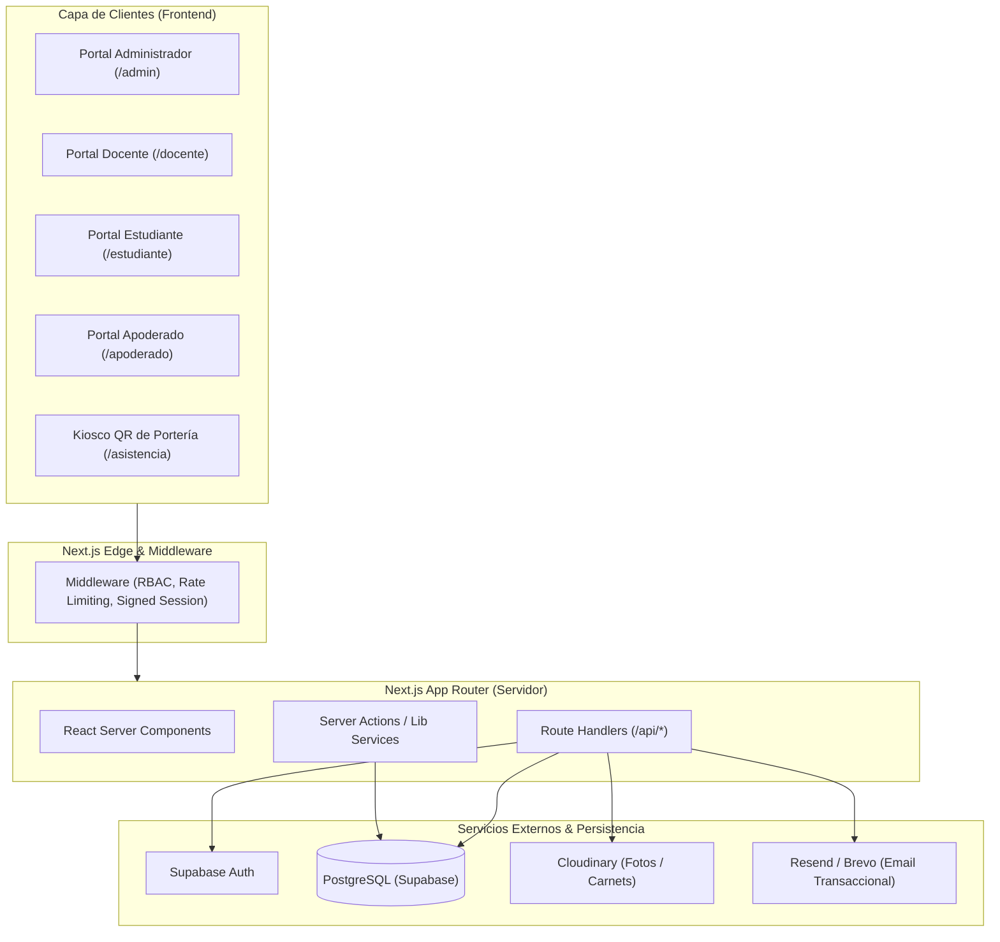

# Arquitectura del Sistema: ColeSistemaMini

Este documento describe la arquitectura técnica, componentes clave, flujo de datos y modelo de seguridad de **ColeSistemaMini**.

---

## 1. Visión General de la Solución

ColeSistemaMini es una plataforma web moderna para la gestión escolar de Educación Básica Regular (Inicial, Primaria y Secundaria). Está construida sobre el ecosistema **Next.js (App Router)** y utiliza servicios serverless para autenticación, base de datos relacional, almacenamiento de medios y entrega de notificaciones.

---

## 2. Componentes y Capas de la Aplicación

### A. Capa de Presentación (UI & UX)
- **Framework:** Next.js 14 con TypeScript y Tailwind CSS.
- **Componentes Atómicos Reutilizables:** Diseñados bajo principios de Atomic Design en `src/components/ui/` (`DataTable`, `StatCard`, `Modal`, `Badge`, `NotificationCenter`).
- **Componentes de Dominio:** Elementos específicos como `GradeBadge` (AD, A, B, C), `QrCard`, `QrScanner` y `EvaluationCalendar`.

### B. Capa de Enrutamiento y Seguridad (Middleware)
- Ubicación: `src/middleware.ts`.
- **Control de Acceso Basado en Roles (RBAC):** Restringe el acceso a rutas `/admin/*`, `/docente/*`, `/estudiante/*` y `/apoderado/*` evaluando sesiones validadas.
- **Firmas de Sesión:** Emplea HMAC SHA-256 (`SESSION_SECRET`) para impedir la manipulación y forja de cookies en el cliente.
- **Defensas Anti-Abuso:** Rate limiting por IP y cabeceras seguras para prevenir fuerza bruta y escaneo automatizado.

### C. Capa de Servicios y Lógica de Negocio
- Ubicación: `src/lib/services/`.
- `authService.ts`: Gestión de login, roles y credenciales.
- `attendanceService.ts`: Procesamiento de asistencias por QR o lista manual.
- `gradeService.ts`: Registro de notas bimestrales, cálculo de conclusiones CNEB y promedios.
- `brandingService.ts`: Personalización institucional en tiempo real.
- `siagieExportService.ts`: Generación de archivos CSV compatibles con la plataforma oficial MINEDU (UTF-8 BOM).

### D. Capa de Integraciones Externas
- **Supabase:** Base de datos PostgreSQL relacional y autenticación centralizada.
- **Cloudinary:** Almacenamiento optimizado de fotografías de perfil y plantillas de carnet.
- **Resend / Brevo:** Envío de correos de bienvenida, alertas de asistencia y comunicados.

---

## 3. Flujo de Datos Clave

### Flujo 1: Registro de Asistencia por Kiosco QR
1. El estudiante presenta su carnet físico o digital ante la cámara o lector de código de barras USB.
2. El escáner decodifica el identificador y envía la solicitud a la API de asistencia.
3. El sistema valida la pertenencia del alumno y registra la marca horaria con estado (*Presente*, *Tardanza* o *Falta*).
4. El cliente emite confirmación sonora mediante Web Audio API y animación gráfica.
5. Se dispara en segundo plano la alerta para el portal del apoderado.

### Flujo 2: Registro de Calificaciones y Exportación SIAGIE
1. El docente ingresa al registro auxiliar por curso y periodo.
2. Puede realizar asignación masiva de calificaciones por competencia o editar individualmente.
3. El asistente sugiere conclusiones descriptivas automáticas según el nivel de logro.
4. Al cerrar el periodo, el módulo directivo consolida la información y genera el archivo CSV con la estructura requerida por el SIAGIE del MINEDU.
