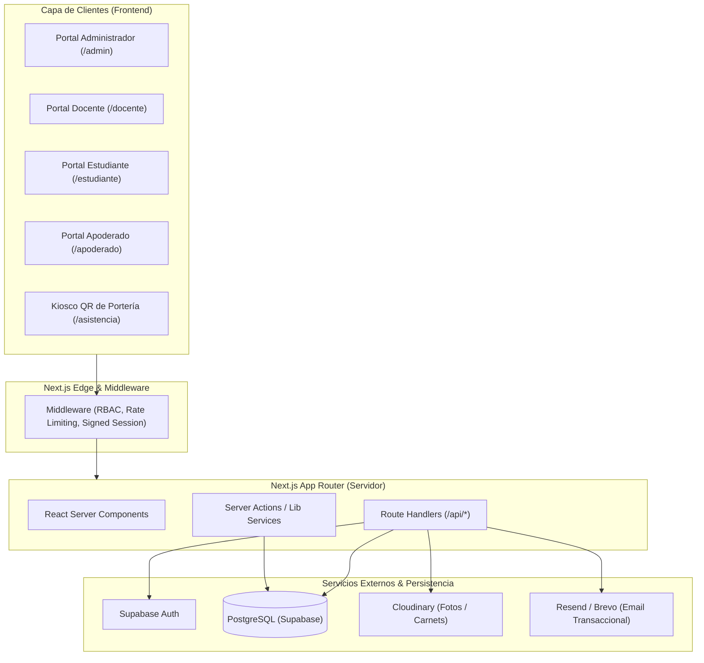
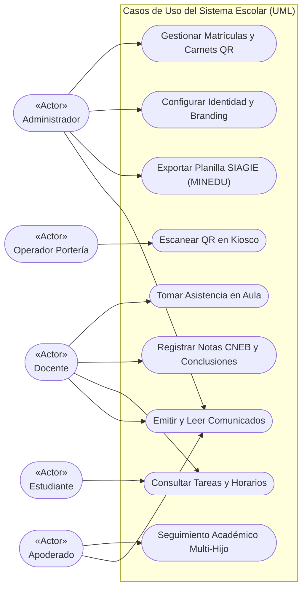
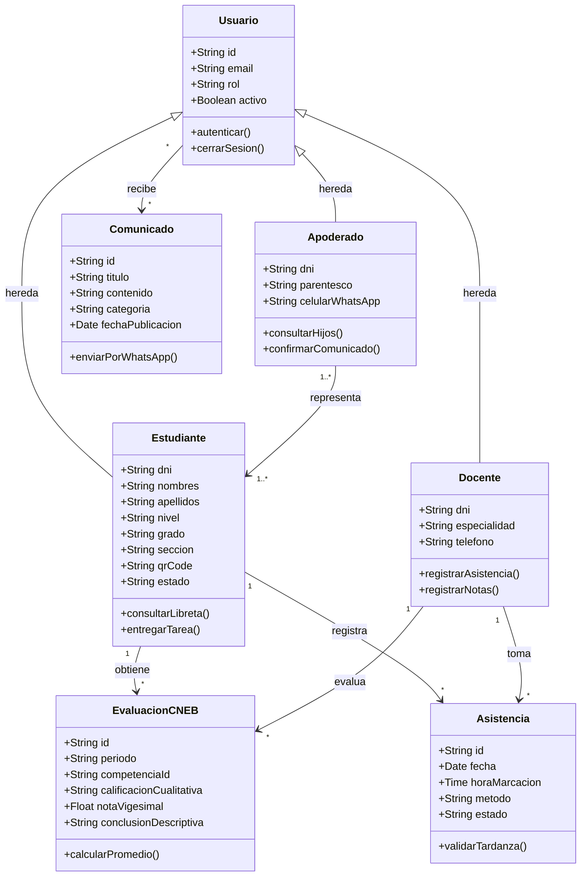
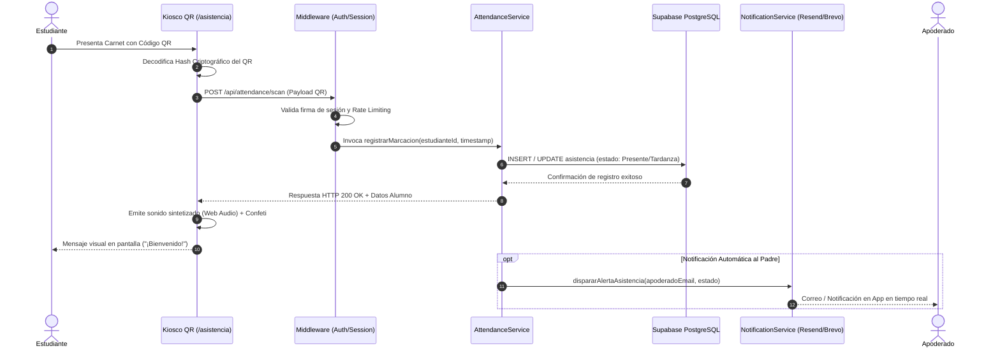
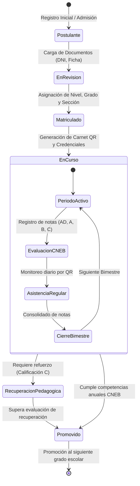

# Arquitectura del Sistema: ColeSistemaMini

Este documento describe la arquitectura técnica, componentes clave, flujo de datos, modelo de seguridad y la metodología de ingeniería de software **RUP (Rational Unified Process)** con modelado **UML (Unified Modeling Language)** de **ColeSistemaMini**.

---

## 1. Visión General de la Solución

ColeSistemaMini es una plataforma web moderna para la gestión escolar de Educación Básica Regular (Inicial, Primaria y Secundaria). Está construida sobre el ecosistema **Next.js (App Router)** y utiliza servicios serverless para autenticación, base de datos relacional, almacenamiento de medios y entrega de notificaciones.

---

## 2. Metodología RUP (Rational Unified Process)

El desarrollo del proyecto se estructura en base a las 4 fases de RUP y sus disciplinas clave:

### Fases del Ciclo de Vida RUP

1. **Fase de Inicio (Inception):**
   - **Objetivo:** Definir la visión del producto escolar, delimitación del alcance y viabilidad técnica.
   - **Entregables:** Documento de visión y contexto (`contexto.md`), identificación de actores (Directores, Docentes, Estudiantes, Apoderados, Operador de Kiosco) y casos de uso críticos.
   - **Alcance estricto:** Educación Básica Regular (EBR) — Inicial, Primaria y Secundaria.

2. **Fase de Elaboración (Elaboration):**
   - **Objetivo:** Establecer la línea base arquitectónica ejecutable y mitigar los riesgos principales.
   - **Mitigación de Riesgos:** Auditoría de seguridad (Claude-BugHunter), resolución de vulnerabilidades críticas en cookies mediante firmas HMAC SHA-256 (`SESSION_SECRET`), diseño del esquema relacional en PostgreSQL (Supabase) y definición del sistema de componentes atómicos.

3. **Fase de Construcción (Construction):**
   - **Objetivo:** Desarrollo iterativo e incremental de la funcionalidad completa del sistema escolar:
     - *Iteración 1:* Sistema bi-modal de asistencia por QR y lectoras USB con feedback de audio y confeti.
     - *Iteración 2:* Registro de calificaciones CNEB (AD, A, B, C) con asistente de conclusiones descriptivas y exportador oficial SIAGIE MINEDU.
     - *Iteración 3:* Módulo de admisiones y matrículas masivas (Excel/CSV), generación de planillas A4 de carnets y portal apoderado multi-hijo.
     - *Iteración 4:* Aula virtual LMS, tareas escolares y comunicados multicanal con acuse de lectura y formateo a WhatsApp.

4. **Fase de Transición (Transition):**
   - **Objetivo:** Despliegue en producción en Vercel, aseguramiento de calidad con 177 pruebas unitarias automatizadas (Vitest) y pruebas E2E con Playwright, elaboración de manuales de usuario y entrega operativa.

---

## 3. Especificación y Modelado UML

### A. Diagrama de Casos de Uso (UML Use Case Diagram)

---

### B. Diagrama de Clases del Dominio (UML Class Diagram)

---

### C. Diagrama de Secuencia (UML Sequence Diagram): Control de Asistencia QR

---

### D. Diagrama de Estados (UML State Machine Diagram): Ciclo de Vida del Estudiante

---

## 4. Componentes y Capas de la Aplicación

### A. Capa de Presentación (UI & UX)
- **Framework:** Next.js 14 con TypeScript y Tailwind CSS.
- **Componentes Atómicos Reutilizables:** Diseñados bajo principios de Atomic Design en `src/components/ui/` (`DataTable`, `StatCard`, `Modal`, `Badge`, `NotificationCenter`).
- **Componentes de Dominio:** Elementos específicos como `GradeBadge` (AD, A, B, C), `QrCard`, `QrScanner` y `EvaluationCalendar`.

### B. Capa de Enrutamiento y Seguridad (Middleware)
- Ubicación: `src/middleware.ts`.
- **Control de Acceso Basado en Roles (RBAC):** Restringe el acceso a rutas `/admin/*`, `/docente/*`, `/estudiante/*` y `/apoderado/*` evaluando sesiones validadas.
- **Firmas de Sesión:** Emplea HMAC SHA-256 (`SESSION_SECRET`) para impedir la manipulación y forja de cookies en el cliente.
- **Defensas Anti-Abuso:** Rate limiting por IP y cabeceras seguras para prevenir fuerza bruta y escaneo automatizado.

### C. Capa de Servicios y Lógica de Negocio
- Ubicación: `src/lib/services/`.
- `authService.ts`: Gestión de login, roles y credenciales.
- `attendanceService.ts`: Procesamiento de asistencias por QR o lista manual.
- `gradeService.ts`: Registro de notas bimestrales, cálculo de conclusiones CNEB y promedios.
- `brandingService.ts`: Personalización institucional en tiempo real.
- `siagieExportService.ts`: Generación de archivos CSV compatibles con la plataforma oficial MINEDU (UTF-8 BOM).

### D. Capa de Integraciones Externas
- **Supabase:** Base de datos PostgreSQL relacional y autenticación centralizada.
- **Cloudinary:** Almacenamiento optimizado de fotografías de perfil y plantillas de carnet.
- **Resend / Brevo:** Envío de correos de bienvenida, alertas de asistencia y comunicados.
